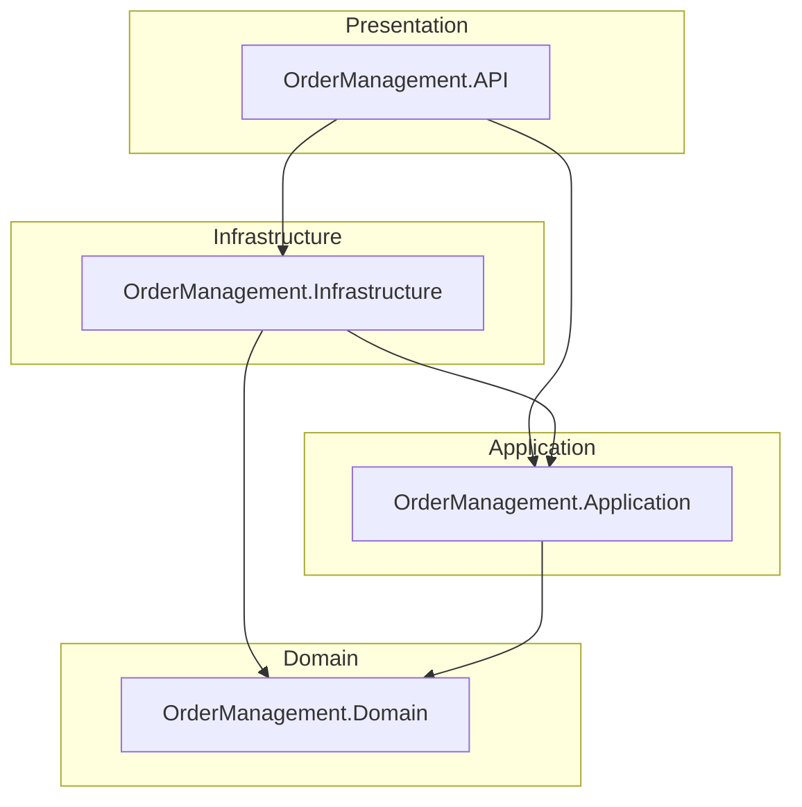
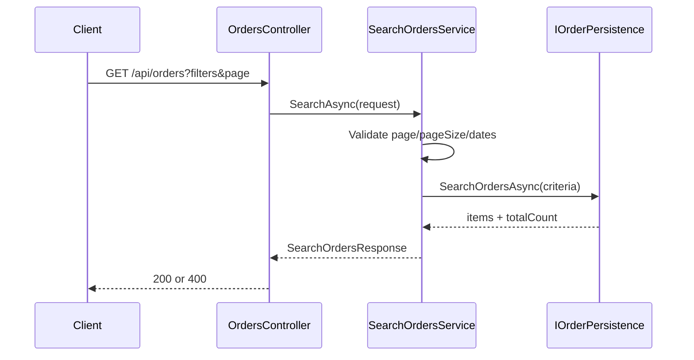
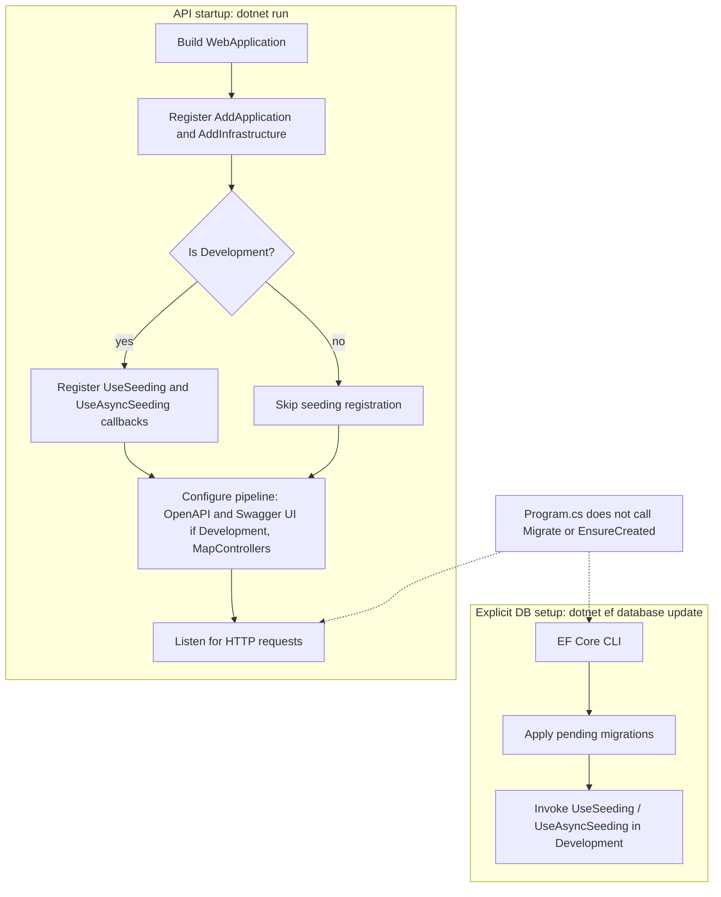

# Order Management

.NET 10 solution for a technical assessment: an order-management API built with Clean Architecture. The domain model, SQL Server persistence (EF Core migrations and Development seed data), create/get/search order use cases, and related HTTP endpoints are in place. Inventory enforcement on confirmation, status transitions, deletion, and authentication are not implemented yet.

## Tech stack

| Technology | Version / notes |
|------------|-----------------|
| .NET | 10.0 (`net10.0`) |
| ASP.NET Core | Web API host (`OrderManagement.API`) |
| Entity Framework Core | 10.0.13 (SQL Server provider) |
| Bogus | 35.6.5 (Development seed data) |
| OpenAPI | `Microsoft.AspNetCore.OpenApi` 10.0.9 |
| Swagger UI | `Swashbuckle.AspNetCore.SwaggerUI` (Development; consumes `/openapi/v1.json`) |
| xUnit / Moq | Unit tests (`OrderManagement.Application.Tests`) |
| Database (Development) | SQL Server LocalDB (`OrderManagement`) |

## Implementation status

| Area | Status | Details |
|------|--------|---------|
| Domain model | **Implemented** | `Customer`, `Product`, `Inventory`, `Order`, `OrderItem`; `OrderStatus` enum (`Pending`, `Confirmed`, `Shipped`, `Delivered`) |
| EF Core persistence | **Implemented** | `AppDbContext`, Fluent API configurations, `InitialCreate` migration |
| Development seeding | **Implemented** | Bogus-based `DevelopmentDataSeeder` via `UseSeeding` / `UseAsyncSeeding` (Development only) |
| Create-order use case | **Implemented** | `CreateOrderService` + `IOrderPersistence`; creates `Pending` order; prices from DB; no inventory check/deduct |
| Get order by ID | **Implemented** | `GetOrderService`; `GET /api/orders/{id}` |
| Search orders | **Implemented** | `SearchOrdersService`; filters, pagination, sort by `CreatedAt` desc then `Id` desc |
| Inventory enforcement | **Not present** | Stock is not validated or updated when creating an order |
| Status changes / deletion | **Not present** | No confirm/cancel/ship or delete endpoints |
| Authentication / authorization policies | **Not present** | Pipeline calls `UseAuthorization()`; no auth configuration or policies |
| Unit tests | **Implemented** | xUnit + Moq for create, get, and search application services |
| API / integration tests | **Not present** | No test project for the API host |

## Clean Architecture

The solution follows Clean Architecture layering. Dependencies point **inward** toward the Domain. Outer layers may reference inner layers; the Domain has no project references.

| Layer | Project | Responsibility |
|-------|---------|----------------|
| Presentation | `OrderManagement.API` | ASP.NET Core host, HTTP pipeline, `OrdersController` |
| Infrastructure | `OrderManagement.Infrastructure` | EF Core, SQL Server, migrations, Development seeding, `OrderPersistence` |
| Application | `OrderManagement.Application` | Order use cases (create/get/search), DTOs/results, `IOrderPersistence` port |
| Domain | `OrderManagement.Domain` | Entities and enums |



## Project structure

```
OrderManagement.sln
src/
├── OrderManagement.API/
│   ├── Controllers/
│   │   └── OrdersController.cs
│   ├── Program.cs
│   ├── appsettings.json
│   └── appsettings.Development.json
├── OrderManagement.Application/
│   ├── DependencyInjection.cs
│   └── Orders/                      # Create/Get/Search services, DTOs, IOrderPersistence
├── OrderManagement.Domain/
│   ├── Entities/
│   └── Enums/
└── OrderManagement.Infrastructure/
    ├── DependencyInjection.cs
    └── Persistence/
        ├── AppDbContext.cs
        ├── OrderPersistence.cs
        ├── DevelopmentDataSeeder.cs
        ├── Configurations/
        └── Migrations/
tests/
└── OrderManagement.Application.Tests/
    └── Orders/
        ├── CreateOrderServiceTests.cs
        ├── GetOrderServiceTests.cs
        └── SearchOrdersServiceTests.cs
```

## Prerequisites

- [.NET 10 SDK](https://dotnet.microsoft.com/download)
- [EF Core command-line tools](https://learn.microsoft.com/ef/core/cli/dotnet) (`dotnet-ef`)
- SQL Server LocalDB (default Development connection), or another SQL Server instance

Install the EF tools if needed:

```bash
dotnet tool install --global dotnet-ef
```

## Local setup

From the repository root:

```bash
dotnet restore
dotnet build
```

## Database: migrations and seed data

Migrations and Development seeding are **not** applied automatically when the API starts. `Program.cs` does not call `Database.Migrate()`, `EnsureCreated()`, or any startup seeding. You must run the EF CLI explicitly.

### Connection string

Development uses `DefaultConnection` in `src/OrderManagement.API/appsettings.Development.json`:

```text
Server=(localdb)\mssqllocaldb;Database=OrderManagement;Trusted_Connection=True;TrustServerCertificate=True;MultipleActiveResultSets=true
```

Update that value if you use a different SQL Server instance.

### Apply migrations and seed (Development)

```bash
dotnet ef database update --project src/OrderManagement.Infrastructure --startup-project src/OrderManagement.API
```

This command:

1. Applies pending EF Core migrations (currently `InitialCreate`)
2. In the Development environment, executes the `UseSeeding` / `UseAsyncSeeding` callbacks registered in Infrastructure DI, which call `DevelopmentDataSeeder`

Seeding is registered **only** when the host environment is Development.

### Seed data summary

| Entity | Count | Notes |
|--------|------:|-------|
| Customers | 50 | Deterministic Bogus data; emails `customer001@example.com` … `customer050@example.com` |
| Products | 200 | Deterministic Bogus commerce data |
| Inventories | 200 | One row per product |
| Orders | 0 | Not seeded |
| OrderItems | 0 | Not seeded |

- Bogus `Randomizer.Seed` is fixed at `42` for reproducible data.
- Seeding is idempotent: existing rows with the same Ids are skipped.

## Running the API

Ensure the database has been updated (see above), then from the repository root:

```bash
dotnet run --project src/OrderManagement.API
```

HTTPS profile (HTTP + HTTPS):

```bash
dotnet run --project src/OrderManagement.API --launch-profile https
```

| Profile | URLs |
|---------|------|
| `http` (default) | `http://localhost:5184` |
| `https` | `https://localhost:7038`, `http://localhost:5184` |

`ASPNETCORE_ENVIRONMENT` is `Development` in both launch profiles. Launch profiles open Swagger UI (`/swagger`).

### OpenAPI and Swagger UI (Development)

| Resource | URL |
|----------|-----|
| OpenAPI document | `/openapi/v1.json` |
| Swagger UI | `/swagger` |

Swagger UI is enabled only in Development and uses the built-in OpenAPI document (no second document generator).

### API endpoints

| Method | Route | Description |
|--------|-------|-------------|
| `POST` | `/api/orders` | Create a new order (`Pending`) |
| `GET` | `/api/orders/{id}` | Get a single order by ID (includes line items) |
| `GET` | `/api/orders` | Search orders with optional filters and pagination |

#### Create order — `POST /api/orders`

**Request body:**

```json
{
  "customerId": "00000000-0000-4000-8000-000000000001",
  "items": [
    { "productId": "00000000-0000-4000-8001-000000000001", "quantity": 1 }
  ]
}
```

| Status | When |
|--------|------|
| **201 Created** | Success; body is order detail; `Location: /api/orders/{orderId}` |
| **400 Bad Request** | Validation failure (empty items, non-positive quantity, duplicate product IDs); body `{ "error": "..." }` |
| **404 Not Found** | Customer or product not found; body `{ "error": "..." }` |

Unit prices come from current `Product.Price`; inventory is not checked or updated.

#### Get order — `GET /api/orders/{id}`

| Status | When |
|--------|------|
| **200 OK** | Order found (includes items) |
| **404 Not Found** | No order with that ID; body `{ "error": "..." }` |

#### Search orders — `GET /api/orders`

**Query parameters (all optional except defaults for paging):**

| Parameter | Description |
|-----------|-------------|
| `customerId` | Filter by customer |
| `status` | Filter by `OrderStatus` (`Pending`, `Confirmed`, `Shipped`, `Delivered`) |
| `createdFrom` | Inclusive lower bound on `CreatedAt` |
| `createdTo` | Inclusive upper bound on `CreatedAt` |
| `page` | Page number (default `1`, must be ≥ 1) |
| `pageSize` | Page size (default `20`, must be 1–100) |

Results are sorted by **`CreatedAt` descending**, then **`Id` descending**. Queries use EF Core `AsNoTracking` with server-side filter/sort/page.

**Example:**

```http
GET /api/orders?customerId=00000000-0000-4000-8000-000000000001&status=Pending&page=1&pageSize=20
```

**Response shape:**

```json
{
  "items": [ /* order detail objects */ ],
  "page": 1,
  "pageSize": 20,
  "totalCount": 0
}
```

| Status | When |
|--------|------|
| **200 OK** | Success (empty `items` when no matches) |
| **400 Bad Request** | Invalid pagination or `createdFrom` > `createdTo`; body `{ "error": "..." }` |



## Testing

Application-layer unit tests live in `tests/OrderManagement.Application.Tests` (xUnit + Moq; `IOrderPersistence` is mocked). There are no API or integration tests.

From the repository root:

```bash
dotnet test
```

## Entity relationship diagram

Relationships match the Fluent API configurations (delete behaviors noted below).

| Relationship | Cardinality | Delete behavior |
|--------------|-------------|-----------------|
| Customer → Order | 1 : N | Restrict |
| Order → OrderItem | 1 : N | Cascade |
| Product → OrderItem | 1 : N | Restrict |
| Product → Inventory | 1 : 0..1 | Restrict (unique `ProductId`) |

`Order.Status` is stored as `int` and maps to `OrderStatus`: `Pending`, `Confirmed`, `Shipped`, `Delivered`.

```mermaid
erDiagram
  Customer ||--o{ Order : places
  Order ||--|{ OrderItem : contains
  Product ||--o{ OrderItem : "ordered as"
  Product ||--o| Inventory : has

  Customer {
    guid Id PK
    string Name
    string Email UK
  }

  Product {
    guid Id PK
    string Name
    string Description
    decimal Price
    datetimeoffset CreatedAt
    datetimeoffset UpdatedAt
  }

  Inventory {
    guid Id PK
    guid ProductId FK_UK
    int Quantity
    datetimeoffset UpdatedAt
  }

  Order {
    guid Id PK
    guid CustomerId FK
    int Status
    decimal TotalAmount
    datetimeoffset CreatedAt
    datetimeoffset UpdatedAt
  }

  OrderItem {
    guid Id PK
    guid OrderId FK
    guid ProductId FK
    int Quantity
    decimal UnitPrice
  }
```

## Application startup and database initialization

Migrations and seeding run only through the EF CLI path below—not during `dotnet run`.


