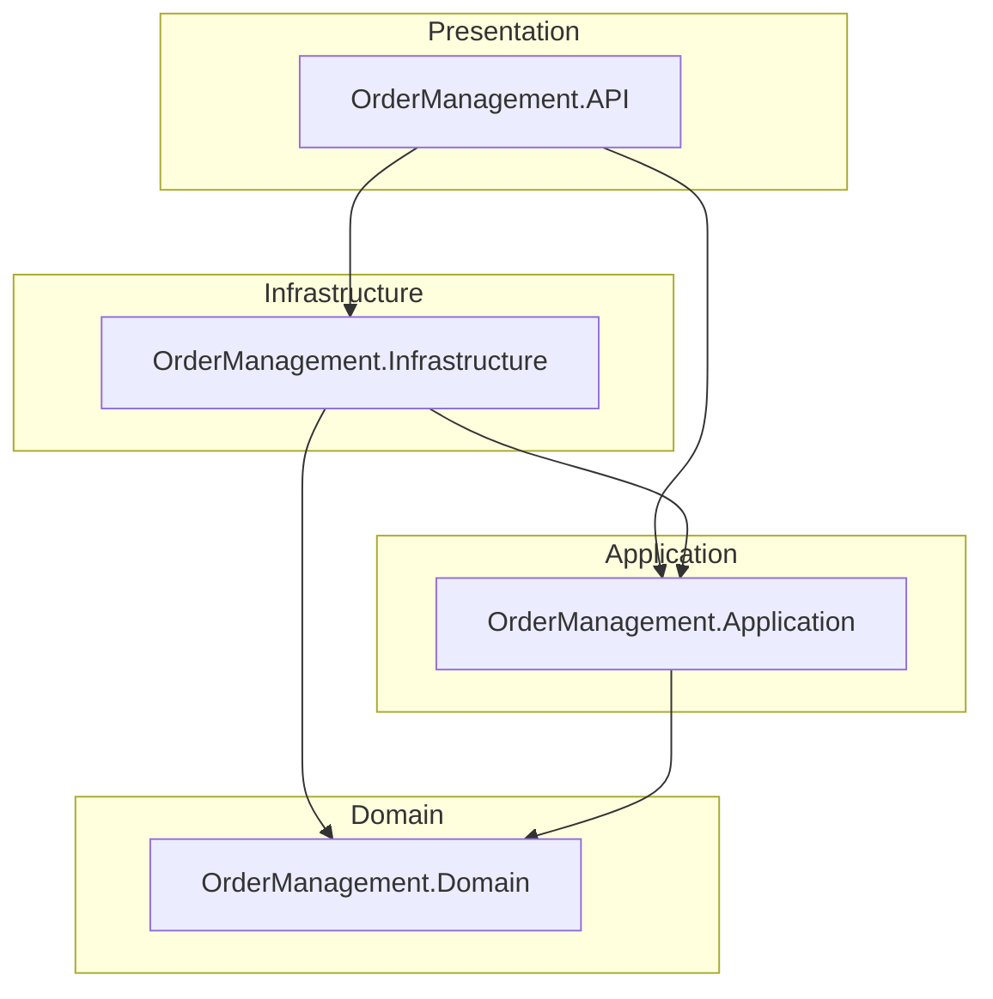
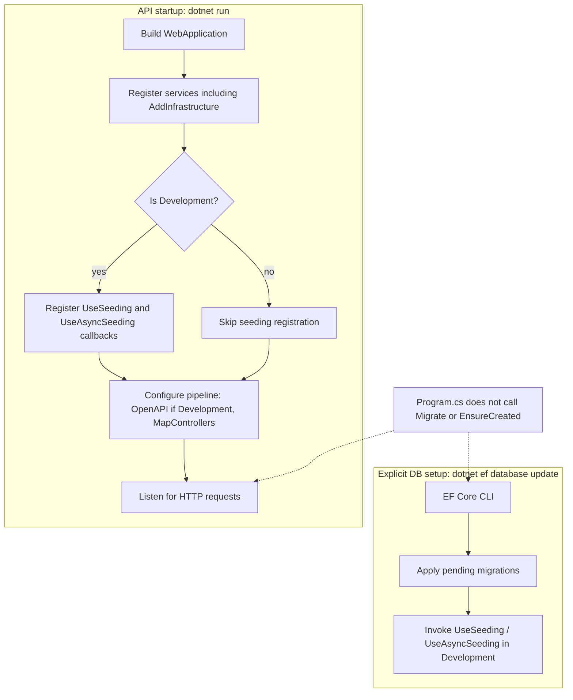

# Order Management

.NET 10 solution for a technical assessment: an order-management API built with Clean Architecture. The domain model and SQL Server persistence layer (EF Core migrations and Development seed data) are in place. Application use cases and HTTP business endpoints are not implemented yet.

## Tech stack

| Technology | Version / notes |
|------------|-----------------|
| .NET | 10.0 (`net10.0`) |
| ASP.NET Core | Web API host (`OrderManagement.API`) |
| Entity Framework Core | 10.0.13 (SQL Server provider) |
| Bogus | 35.6.5 (Development seed data) |
| OpenAPI | `Microsoft.AspNetCore.OpenApi` 10.0.9 |
| Database (Development) | SQL Server LocalDB (`OrderManagement`) |

## Implementation status

| Area | Status | Details |
|------|--------|---------|
| Domain model | **Implemented** | `Customer`, `Product`, `Inventory`, `Order`, `OrderItem`; `OrderStatus` enum (`Pending`, `Confirmed`, `Shipped`, `Delivered`) |
| EF Core persistence | **Implemented** | `AppDbContext`, Fluent API configurations, `InitialCreate` migration |
| Development seeding | **Implemented** | Bogus-based `DevelopmentDataSeeder` via `UseSeeding` / `UseAsyncSeeding` (Development only) |
| API host scaffolding | **Implemented** | DI registration, controllers pipeline, HTTPS redirection, Development OpenAPI document mapping |
| Application layer | **Scaffolded** | Project exists and is referenced; **no application source files** (no use cases, handlers, or interfaces yet) |
| HTTP business endpoints | **Not present** | No controllers or minimal APIs; `MapControllers()` has nothing to map |
| Authentication / authorization policies | **Not present** | Pipeline calls `UseAuthorization()`; no auth configuration or policies |
| Automated tests | **Not present** | No test projects in the solution |

## Clean Architecture

The solution follows Clean Architecture layering. Dependencies point **inward** toward the Domain. Outer layers may reference inner layers; the Domain has no project references.

| Layer | Project | Responsibility |
|-------|---------|----------------|
| Presentation | `OrderManagement.API` | ASP.NET Core host, HTTP pipeline |
| Infrastructure | `OrderManagement.Infrastructure` | EF Core, SQL Server, migrations, Development seeding |
| Application | `OrderManagement.Application` | Intended for use cases / application services (**currently empty**) |
| Domain | `OrderManagement.Domain` | Entities and enums |



## Project structure

```
OrderManagement.sln
src/
├── OrderManagement.API/                 # ASP.NET Core host
│   ├── Program.cs
│   ├── appsettings.json
│   └── appsettings.Development.json
├── OrderManagement.Application/         # Use cases (empty shell)
├── OrderManagement.Domain/
│   ├── Entities/                        # Customer, Product, Inventory, Order, OrderItem
│   └── Enums/                           # OrderStatus
└── OrderManagement.Infrastructure/
    ├── DependencyInjection.cs
    └── Persistence/
        ├── AppDbContext.cs
        ├── DevelopmentDataSeeder.cs
        ├── Configurations/              # Fluent API entity configurations
        └── Migrations/                  # InitialCreate
```

## Prerequisites

- [.NET 10 SDK](https://dotnet.microsoft.com/download)
- [EF Core command-line tools](https://learn.microsoft.com/ef/core/cli/dotnet) (`dotnet-ef`)
- SQL Server LocalDB (default Development connection), or another SQL Server instance

Install the EF tools if needed:

```bash
dotnet tool install --global dotnet-ef
```

## Local setup

From the repository root:

```bash
dotnet restore
dotnet build
```

## Database: migrations and seed data

Migrations and Development seeding are **not** applied automatically when the API starts. `Program.cs` does not call `Database.Migrate()`, `EnsureCreated()`, or any startup seeding. You must run the EF CLI explicitly.

### Connection string

Development uses `DefaultConnection` in `src/OrderManagement.API/appsettings.Development.json`:

```text
Server=(localdb)\mssqllocaldb;Database=OrderManagement;Trusted_Connection=True;TrustServerCertificate=True;MultipleActiveResultSets=true
```

Update that value if you use a different SQL Server instance.

### Apply migrations and seed (Development)

```bash
dotnet ef database update --project src/OrderManagement.Infrastructure --startup-project src/OrderManagement.API
```

This command:

1. Applies pending EF Core migrations (currently `InitialCreate`)
2. In the Development environment, executes the `UseSeeding` / `UseAsyncSeeding` callbacks registered in Infrastructure DI, which call `DevelopmentDataSeeder`

Seeding is registered **only** when the host environment is Development.

### Seed data summary

| Entity | Count | Notes |
|--------|------:|-------|
| Customers | 50 | Deterministic Bogus data; emails `customer001@example.com` … `customer050@example.com` |
| Products | 200 | Deterministic Bogus commerce data |
| Inventories | 200 | One row per product |
| Orders | 0 | Not seeded |
| OrderItems | 0 | Not seeded |

- Bogus `Randomizer.Seed` is fixed at `42` for reproducible data.
- Seeding is idempotent: existing rows with the same Ids are skipped.

## Running the API

Ensure the database has been updated (see above), then from the repository root:

```bash
dotnet run --project src/OrderManagement.API
```

HTTPS profile (HTTP + HTTPS):

```bash
dotnet run --project src/OrderManagement.API --launch-profile https
```

| Profile | URLs |
|---------|------|
| `http` (default) | `http://localhost:5184` |
| `https` | `https://localhost:7038`, `http://localhost:5184` |

`ASPNETCORE_ENVIRONMENT` is `Development` in both launch profiles.

In Development, the OpenAPI document is mapped via `MapOpenApi()`. There are **no business API endpoints** yet (no controllers or minimal APIs).

## Testing

Automated tests are **not present**. The solution does not include test projects (xUnit, NUnit, MSTest, or otherwise). There are no test commands to run at this time.

## Entity relationship diagram

Relationships match the Fluent API configurations (delete behaviors noted below).

| Relationship | Cardinality | Delete behavior |
|--------------|-------------|-----------------|
| Customer → Order | 1 : N | Restrict |
| Order → OrderItem | 1 : N | Cascade |
| Product → OrderItem | 1 : N | Restrict |
| Product → Inventory | 1 : 0..1 | Restrict (unique `ProductId`) |

`Order.Status` is stored as `int` and maps to `OrderStatus`: `Pending`, `Confirmed`, `Shipped`, `Delivered`.

```mermaid
erDiagram
  Customer ||--o{ Order : places
  Order ||--|{ OrderItem : contains
  Product ||--o{ OrderItem : "ordered as"
  Product ||--o| Inventory : has

  Customer {
    guid Id PK
    string Name
    string Email UK
  }

  Product {
    guid Id PK
    string Name
    string Description
    decimal Price
    datetimeoffset CreatedAt
    datetimeoffset UpdatedAt
  }

  Inventory {
    guid Id PK
    guid ProductId FK_UK
    int Quantity
    datetimeoffset UpdatedAt
  }

  Order {
    guid Id PK
    guid CustomerId FK
    int Status
    decimal TotalAmount
    datetimeoffset CreatedAt
    datetimeoffset UpdatedAt
  }

  OrderItem {
    guid Id PK
    guid OrderId FK
    guid ProductId FK
    int Quantity
    decimal UnitPrice
  }
```

## Application startup and database initialization

Migrations and seeding run only through the EF CLI path below—not during `dotnet run`.


